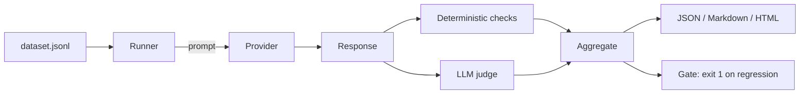

# LLM Eval Harness

[](https://github.com/cliffhop23/llm-eval-harness/actions/workflows/ci.yml)
[](https://www.python.org/)
[](LICENSE)

A small, dependency-light framework for **evaluating LLM outputs** and gating prompt/model changes
in CI. It combines deterministic assertions with optional LLM-as-judge rubric scoring, and produces
JSON, Markdown, and standalone HTML reports.

```bash
pip install -e ".[dev]"
llm-eval run --dataset datasets/support_qa.jsonl --out reports/run.json --html reports/run.html
```

Runs offline with a deterministic mock provider — no API key required for the demo or CI.

## Why

Prompt and model changes are easy to ship and hard to trust. A test suite for model behavior needs:

- **Datasets** of realistic cases (JSONL, versioned in git)
- **Deterministic checks** (contains, regex, JSON validity, length, exact match)
- **Rubric judging** for qualities that can't be asserted (tone, helpfulness, safety)
- **A gate** so a regression fails the build instead of reaching users
- **A report** a human can read

This project packages those pieces into a CLI with a pluggable provider layer.

## Features

- **Provider abstraction** — OpenAI-compatible HTTP APIs (OpenAI, DeepSeek, vLLM, Ollama `/v1`) or a
  deterministic mock provider for tests.
- **Deterministic checks** — `contains`, `not_contains`, `regex`, `json`, `max_words`, `exact`.
- **LLM-as-judge** — rubric prompt, JSON score parsing, robust extraction from code fences.
- **Regression gating** — `--min-pass-rate` and `--min-judge` fail the command (exit 1) on regressions.
- **Reports** — JSON (machine), Markdown (PR comment), HTML (standalone dashboard).
- **Compare runs** — `llm-eval compare baseline.json current.json` shows deltas and regressions.
- **Async execution** with bounded concurrency and per-call latency tracking.

## Quick start (no API key)

```bash
pip install -e ".[dev]"
llm-eval init                                  # writes a sample dataset
llm-eval run --dataset datasets/support_qa.jsonl \
             --out reports/run.json --html reports/run.html
llm-eval compare reports/run.json reports/run.json
```

Example output:

```
        Evaluation summary
┌──────────────────────┬───────────┐
│ Cases                │ 4         │
│ Check pass rate      │ 100.0%    │
│ Mean judge score     │ 4.50 / 5  │
│ Latency p50 / p95    │ 8 / 12 ms │
│ Tokens               │ 212       │
└──────────────────────┴───────────┘
```

## Using a real model

Any OpenAI-compatible endpoint works:

```bash
export OPENAI_API_KEY=sk-...
llm-eval run --dataset datasets/support_qa.jsonl \
  --provider openai \
  --base-url https://api.openai.com/v1 \
  --model gpt-4o-mini \
  --min-pass-rate 0.9 \
  --min-judge 4.0
```

For Ollama:

```bash
llm-eval run --provider openai --base-url http://localhost:11434/v1 \
  --model llama3.1 --api-key-env OLLAMA_API_KEY
```

## Dataset format

One JSON object per line:

```json
{
  "id": "late-order",
  "prompt": "Customer says: 'My order #A123 is late.' Reply in one sentence.",
  "checks": [
    {"type": "contains", "value": "A123"},
    {"type": "max_words", "value": "40"}
  ],
  "rubric": "Empathetic, mentions the order number, offers a next step, concise.",
  "mock_response": "Sorry about the delay with A123 — here is your tracking link: ...",
  "mock_judge": {"score": 5, "reason": "Empathetic and specific."}
}
```

`mock_response` / `mock_judge` are only used by the mock provider, which makes the sample dataset a
fully deterministic end-to-end demo.

## Reports

- `reports/run.json` — full results, summary, per-case checks and judge scores
- `reports/run.md` — table for a PR comment
- `reports/run.html` — self-contained dashboard with pass/fail and judge scores

## Architecture



## CI

```yaml
- run: pip install -e ".[dev]"
- run: ruff check .
- run: pytest -q
- run: llm-eval run --dataset datasets/support_qa.jsonl --min-pass-rate 0.9 --min-judge 4.0
```

## Roadmap

- [ ] Pairwise A/B judging with win rates
- [ ] Bootstrap confidence intervals on scores
- [ ] Caching provider responses for reproducible runs
- [ ] Per-check weights

## License

MIT © 2026 Thomas Hopkinson
